# Alzheimer's Papers RAG

A retrieval-augmented question-answering system over 19 Alzheimer's disease research papers.
Ask a question in plain English and get an answer written **only from the papers**, with
numbered citations pointing to the exact passage, section and page it came from. When the
papers don't contain the answer, it says so instead of guessing.

Built end to end in Python: PDF parsing → chunking → embeddings in **PostgreSQL + pgvector** →
retrieval → LLM answer with citations → **FastAPI** REST API → an evaluation suite with known
answers, used to compare a local LLM with a cloud LLM.

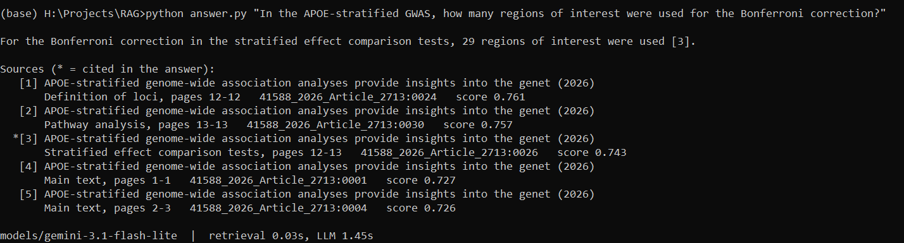

## How it works

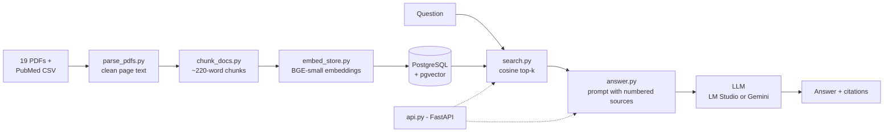

| Step | File | What it does |
|---|---|---|
| Parse | [`parse_pdfs.py`](parse_pdfs.py) | PyMuPDF text extraction with reading-order fixes for two-column pages and sidebars, header/footer and reference-list removal, heading detection, de-hyphenation; attaches title/authors/year/DOI from the PubMed CSV |
| Chunk | [`chunk_docs.py`](chunk_docs.py) | Section-aware chunks (~220 words, hard cap 320, 40-word overlap); drops front matter, affiliations and boilerplate sections (funding, conflicts of interest, ...) |
| Embed & store | [`embed_store.py`](embed_store.py) | Embeds with `BAAI/bge-small-en-v1.5` (local, 384 dims) and upserts into Postgres/pgvector with an HNSW index; keeps the table identical to `chunks.jsonl` |
| Retrieve | [`search.py`](search.py) | Cosine-similarity top-k search; also a CLI to inspect retrieval on its own |
| Answer | [`answer.py`](answer.py) | Numbers the retrieved passages, instructs the LLM to answer only from them and cite `[n]`, or reply that the papers don't contain the answer |
| Serve | [`api.py`](api.py) | FastAPI: `POST /ask`, `GET /search`, `GET /health`, Swagger UI at `/docs` |
| Evaluate | [`evaluate.py`](evaluate.py) | Runs the test questions; scores retrieval (hit@k, MRR), answers, citations and refusals per question type |

Any OpenAI-compatible chat API works as the LLM: the backend is chosen in `.env`, so the same
code runs against a local model in LM Studio or Google's Gemini API.

## Numbers

Measured with [`evaluate.py`](evaluate.py) on 15 questions with known answers
([`eval_questions.jsonl`](eval_questions.jsonl)): 6 about a paper's findings, 6 asking for a
specific number, and 3 that **cannot** be answered from the papers.

| | Gemini 3.1 Flash-Lite (API) | Qwen3-Coder 30B-A3B (local, LM Studio, Q4_K_M) |
|---|---|---|
| Answerable questions answered correctly | **12 / 12** | 11 / 12 |
| Answer cites a passage containing the answer | 12 / 12 | 12 / 12 |
| Unanswerable questions correctly refused | 3 / 3 | 3 / 3 |
| Average time per answer | ~3 s | ~19 s |

Retrieval alone (same for both models, top 5 passages):

| | hit@5 | hit@1 | MRR |
|---|---|---|---|
| Finding questions (6) | 6 / 6 | 1 / 6 | 0.50 |
| Number-lookup questions (6) | 6 / 6 | 3 / 6 | 0.69 |
| **All answerable (12)** | **12 / 12** | **4 / 12** | **0.60** |

*hit@k: the passage containing the answer is among the top k retrieved; MRR: mean reciprocal
rank of that passage (1.0 = always ranked first).* Raw results with every answer are in
[`results/`](results).

What the numbers say:

- **Retrieval always finds the answer, but rarely ranks it first** (usually 2nd–3rd). Passing
  5 passages to the LLM hides this today; with fewer passages, answers would start to go
  missing. This is the main thing to improve next.
- **Number lookups ranked better than findings** (MRR 0.69 vs 0.50) - the opposite of the
  initial expectation. Lookup questions name the study and use specific terms, so they match
  one passage clearly; findings are general claims that compete with similar wording across
  abstracts and discussions.
- **Qwen's one error is a misattribution, not a retrieval failure.** Asked how much
  hippocampal neuron loss 10-month-old APP/PS1KI mice show, it cited the correct passage but
  answered "−14%" - a figure the same review gives for a *different* mouse model (the answer
  is >50%). It repeats the same error on every run (temperature 0).
- **Both models refused all three unanswerable questions**, including a near-miss about a
  trial that *is* in the papers but whose dropout numbers are not reported.

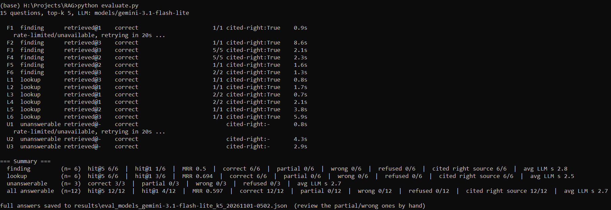

## Design decisions

- **Local embeddings, swappable LLM.** Embeddings run locally (`bge-small-en-v1.5`, ~130 MB,
  CPU is enough), so indexing costs nothing. The LLM sits behind the OpenAI-compatible chat
  API, so a local model (LM Studio) and a hosted one (Gemini) are a `.env` change apart - which
  is what made the model comparison above cheap to run.
- **Chunk size follows the embedding model.** Biomedical text runs ~1.5 tokens per word;
  ~220-word chunks plus a `title | section` header stay well inside BGE's 512-token window
  (a 256-token model such as `all-MiniLM-L6-v2` would silently truncate them).
- **Chunks never cross section boundaries**, and every chunk keeps its paper, section and
  page range, so citations point somewhere a reader can check.
- **Refusal is part of the prompt contract.** The model must cite `[n]` for every claim or
  reply with a fixed "could not find" sentence, which makes refusals measurable.
- **Temperature 0** for answers, so evaluation runs are repeatable.
- **Postgres + pgvector in Docker** rather than a dedicated vector database: one familiar
  database for text, metadata and vectors, started with one command.
- **Keyword scoring with manual review** instead of an LLM judge: with 15 questions, reading
  the flagged answers is faster and more reliable than validating a judge.

## Lessons learned

Things that only showed up by measuring, and what was done about them:

- **PDF parsing was the biggest source of error.** A first version silently lost most of the
  Nature Genetics paper (only 15% of its text reached the index): it's a "Letter" with no
  section headings, and Nature prints the reference list *before* Methods, so "cut everything
  after References" deleted the Methods too. Other fixes: columns read out of order when a
  whole column is a single PDF block (which also leaked reference lists into the text),
  affiliation sidebars interleaved line-by-line into abstracts, hundreds of words broken by
  hyphenation across lines, duplicated text layers, and table headers mistaken for section
  headings. After the fixes: Nature paper 2,102 → 7,470 words indexed; reference-list chunks
  10 → 0; boilerplate chunks 67 → 0; affiliation-list chunks 13 → 0.
- **Symbol fonts produce control characters.** Formulas and p-values in some papers use
  glyphs with no Unicode mapping, which come out as `\x00`–`\x05`; Postgres rejects `\x00`
  ([the error](docs/images/pipeline_embed-store.png)). Their meaning differs per font (`\x02`
  is "×" in one paper and "±" in another), so they are replaced with `�` rather than guessed.
- **Duplicate studies distort answers.** The collection first contained both the preprint and
  the published version of the APOE study; they report different numbers (33 vs 29 regions of
  interest) and took two of the five retrieval slots. The preprint was removed.
- **Question wording matters more than expected.** "How many regions of interest were
  tested?" retrieved brain-imaging papers (where "regions of interest" is a standard term);
  naming the study ranked the correct passage in the top 3.
- **A correct citation doesn't mean a correctly read source.** In a manual test Qwen claimed
  two loci "depend on APOE ε4" while citing the passage that says they don't
  ([screenshot](docs/images/answer_qwen-local.png)). The evaluation therefore checks the
  answer's content, not only that it cites something.
- **Evaluating is its own engineering problem.** The first evaluation flagged correct answers
  as retrieval misses because each fact appears several times in a paper in different words.
  The evidence for each question is now a hand-checked list of passages; a looser automatic
  rule was tried and rejected because it inflated the scores.

## Build and run

Requirements: Python 3.8+, [Docker Desktop](https://www.docker.com/products/docker-desktop/),
and either [LM Studio](https://lmstudio.ai/) with a chat model or a
[Gemini API key](https://aistudio.google.com/apikey).
Commands below are for Windows (Anaconda Prompt); on macOS/Linux use `cp` instead of `copy`.

```bat
:: 1. install
pip install -r requirements.txt

:: 2. start Postgres + pgvector (host port 5433)
docker compose up -d

:: 3. put the PDFs in pdfs\ (see "Data" below), then build the index
python parse_pdfs.py --pdf-dir pdfs --csv pdfs\csv-alzheimer.csv --out parsed
python chunk_docs.py --parsed parsed --out chunks.jsonl
python embed_store.py --chunks chunks.jsonl

:: 4. configure the LLM (edit .env afterwards: LM Studio or Gemini)
copy .env.example .env
python answer.py --list-models

:: 5. ask
python search.py "sex differences in genetic risk for Alzheimer's pathology"
python answer.py "Which variants' effects depend on APOE e4?"

:: 6. evaluate
python evaluate.py --retrieval-only
python evaluate.py

:: 7. run the API, then open http://127.0.0.1:8000/docs
uvicorn api:app --reload

:: when done: stop the database (keeps the data; "down -v" would delete it)
docker compose stop
```

### API

The easiest way to try it is the Swagger page at `http://127.0.0.1:8000/docs`:

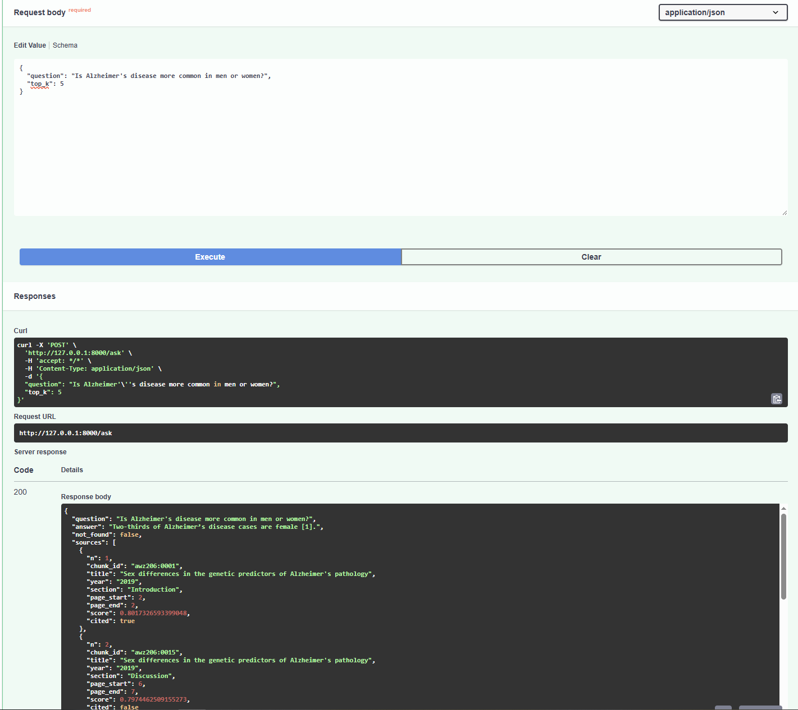

From a terminal (macOS/Linux/Git Bash):

```bash
curl -X POST 'http://127.0.0.1:8000/ask' \
  -H 'Content-Type: application/json' \
  -d '{"question": "Is Alzheimer'\''s disease more common in men or women?", "top_k": 5}'
```

Response (shortened):

```json
{
  "question": "Is Alzheimer's disease more common in men or women?",
  "answer": "Two-thirds of Alzheimer’s disease cases are female [1].",
  "not_found": false,
  "sources": [
    {
      "n": 1,
      "chunk_id": "awz206:0001",
      "title": "Sex differences in the genetic predictors of Alzheimer's pathology",
      "year": "2019",
      "section": "Introduction",
      "page_start": 2,
      "page_end": 2,
      "score": 0.8017,
      "cited": true
    }
  ],
  "llm_model": "qwen3-coder-30b-a3b-instruct",
  "seconds": {"retrieval": 0.03, "llm": 12.31}
}
```

`GET /search?q=...&k=5` returns the retrieved passages without calling the LLM;
`GET /health` reports the database status and configured models.

<details>
<summary>More screenshots</summary>

| | |
|---|---|
| Parsing the PDFs | 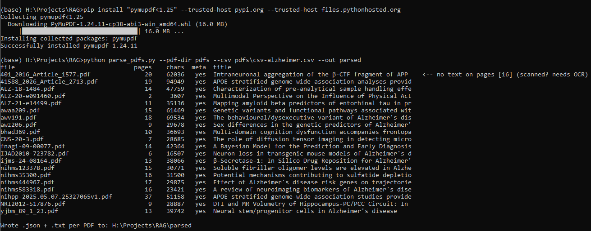 |
| Chunking | 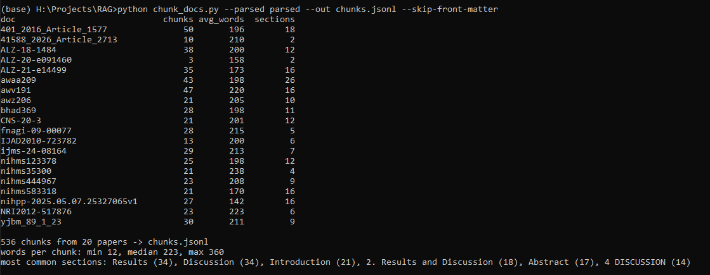 |
| Embedding (with the NUL-byte error and the fixed re-run) | 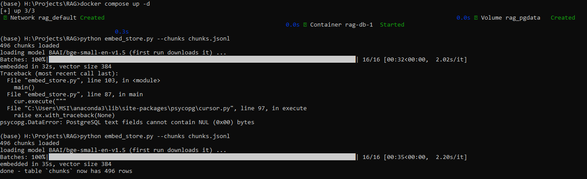 |
| Inspecting the vectors in psql | 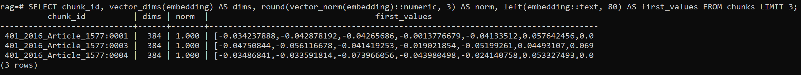 |
| Retrieval only (`search.py`) | 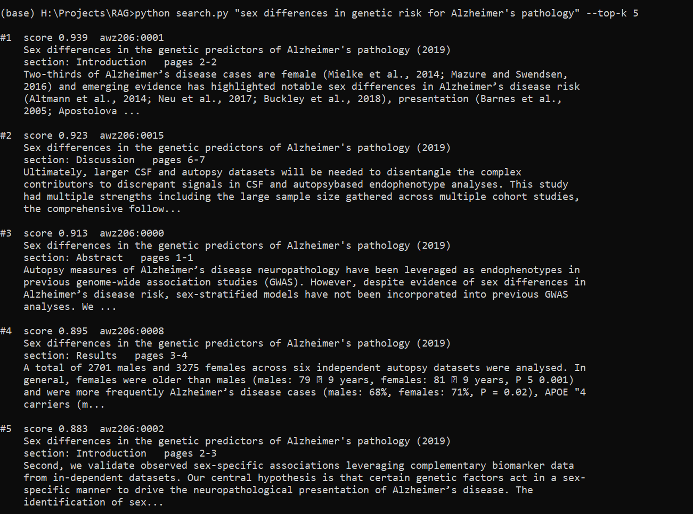 |
| Refusing an unanswerable question | 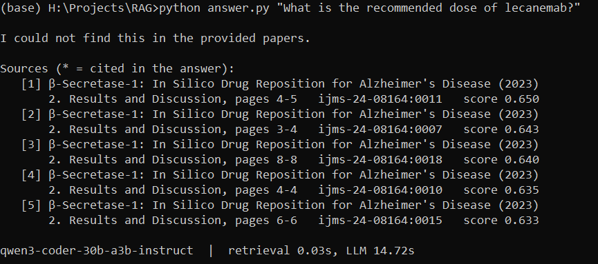 |
| Local model answers (Qwen in LM Studio) | 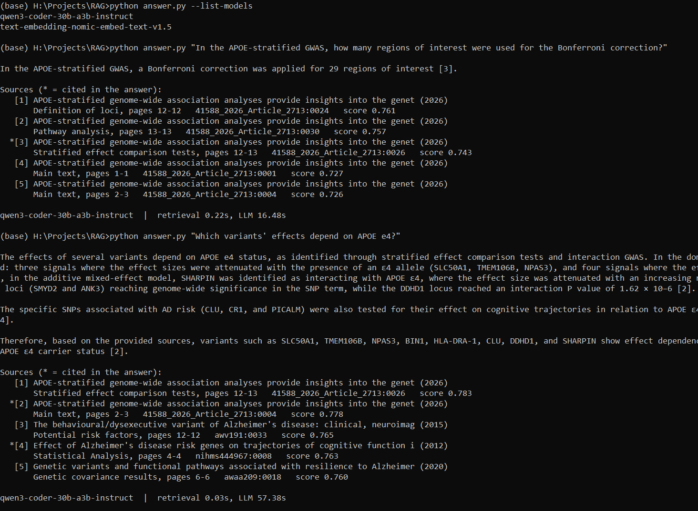 |
| LM Studio server | 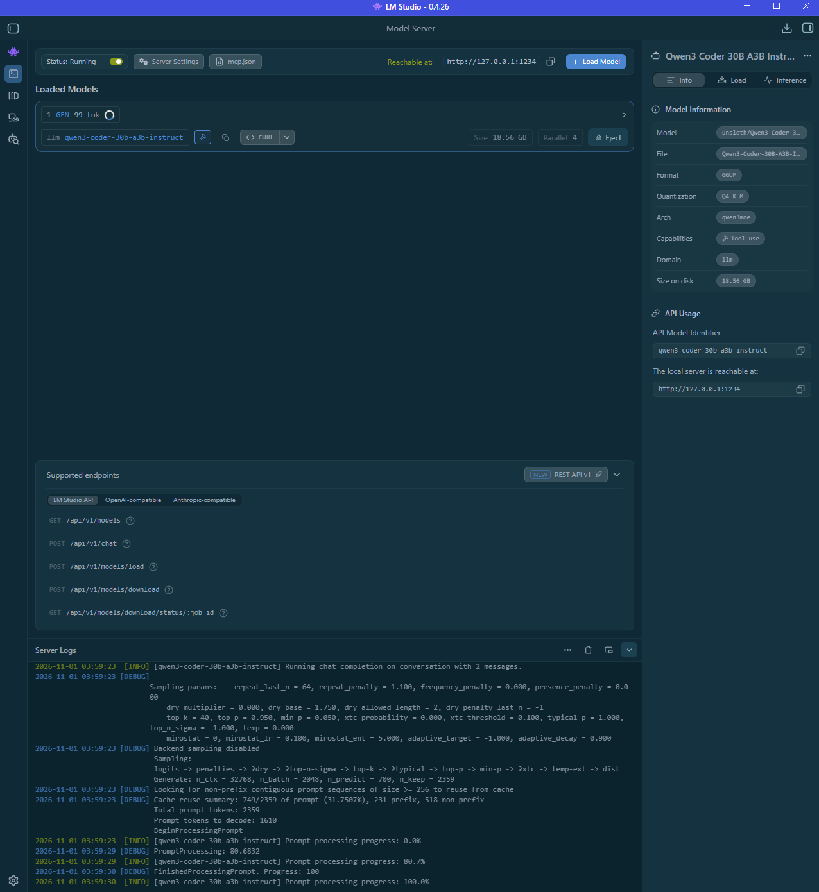 |
| Gemini models available on the free tier | 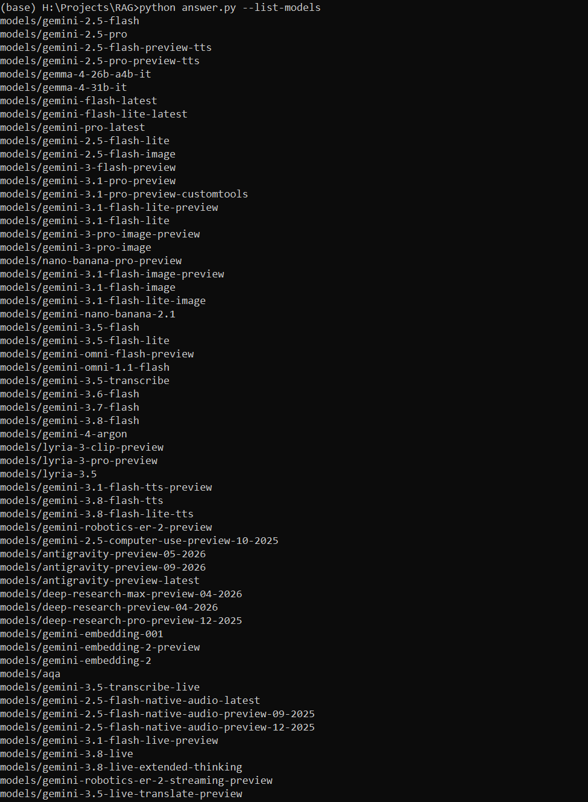 |
| Evaluation - retrieval only | 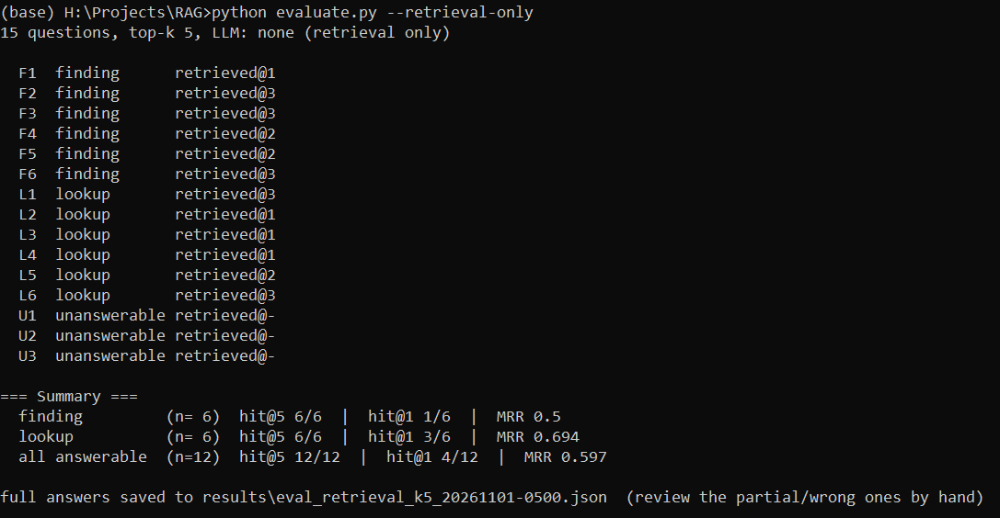 |
| Evaluation - Qwen | 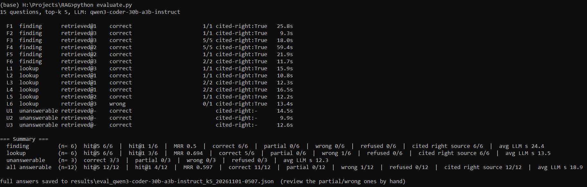 |

</details>

## Data

The 19 papers (2007–2026) are listed below. Their PDFs and extracted text are **not**
included in this repository - copyright stays with the publishers. Download them from the
DOI links (most are open access via PubMed Central) into `pdfs/` and run the pipeline; file
names don't matter, because each PDF is matched to its metadata by DOI.
[`pdfs/csv-alzheimer.csv`](pdfs/csv-alzheimer.csv) is the PubMed export used for titles,
authors and DOIs (it also lists the removed preprint, which is simply unused).

The pipeline isn't tied to these papers: any folder of text-based PDFs works, with an
optional PubMed CSV export for clean citations.

| Year | First author | Title | Journal |
|---|---|---|---|
| 2007 | Han X | [Potential mechanisms contributing to sulfatide depletion at the earliest clinically recognizable stage of Alzheimer's disease: a tale of shotgun lipidomics](https://doi.org/10.1111/j.1471-4159.2007.04708.x) | J Neurochem |
| 2009 | Tomic JL | [Soluble fibrillar oligomer levels are elevated in Alzheimer's disease brain and correlate with cognitive dysfunction](https://doi.org/10.1016/j.nbd.2009.05.024) | Neurobiol Dis |
| 2010 | Wirths O | [Neuron loss in transgenic mouse models of Alzheimer's disease](https://doi.org/10.4061/2010/723782) | Int J Alzheimers Dis |
| 2012 | Palesi F | [DTI and MR Volumetry of Hippocampus-PC/PCC Circuit: In Search of Early Micro- and Macrostructural Signs of Alzheimers's Disease](https://doi.org/10.1155/2012/517876) | Neurol Res Int |
| 2012 | Sweet RA | [Effect of Alzheimer's disease risk genes on trajectories of cognitive function in the Cardiovascular Health Study](https://doi.org/10.1176/appi.ajp.2012.11121815) | Am J Psychiatry |
| 2013 | Varghese T | [A review of neuroimaging biomarkers of Alzheimer's disease](https://pmc.ncbi.nlm.nih.gov/articles/PMC4243931/) | Neurol Asia |
| 2014 | Zhang B | [The role of diffusion tensor imaging in detecting microstructural changes in prodromal Alzheimer's disease](https://doi.org/10.1111/cns.12166) | CNS Neurosci Ther |
| 2015 | Ossenkoppele R | [The behavioural/dysexecutive variant of Alzheimer's disease: clinical, neuroimaging and pathological features](https://doi.org/10.1093/brain/awv191) | Brain |
| 2016 | Lauritzen I | [Intraneuronal aggregation of the β-CTF fragment of APP (C99) induces Aβ-independent lysosomal-autophagic pathology](https://doi.org/10.1007/s00401-016-1577-6) | Acta Neuropathol |
| 2016 | Tincer G | [Neural stem/progenitor cells in Alzheimer's disease](https://pmc.ncbi.nlm.nih.gov/articles/PMC4797833/) | Yale J Biol Med |
| 2017 | Alexiou A | [A Bayesian Model for the Prediction and Early Diagnosis of Alzheimer's Disease](https://doi.org/10.3389/fnagi.2017.00077) | Front Aging Neurosci |
| 2019 | Dumitrescu L | [Sex differences in the genetic predictors of Alzheimer's pathology](https://doi.org/10.1093/brain/awz206) | Brain |
| 2020 | Dumitrescu L | [Genetic variants and functional pathways associated with resilience to Alzheimer's disease](https://doi.org/10.1093/brain/awaa209) | Brain |
| 2022 | Verberk IMW | [Characterization of pre-analytical sample handling effects on a panel of Alzheimer's disease-related blood-based biomarkers: Results from the Standardization of Alzheimer's Blood Biomarkers (SABB) working group](https://doi.org/10.1002/alz.12510) | Alzheimers Dement |
| 2023 | Galeana-Ascencio RA | [β-Secretase-1: In Silico Drug Reposition for Alzheimer's Disease](https://doi.org/10.3390/ijms24098164) | Int J Mol Sci |
| 2023 | Wang D | [Multi-domain cognition dysfunction accompanies frontoparietal and temporal amyloid accumulation in the elderly](https://doi.org/10.1093/cercor/bhad369) | Cereb Cortex |
| 2025 | Haeger A | [Multimodal Perspective on the Influence of Physical Activity on Alzheimer’s Disease](https://doi.org/10.1002/alz.091460) | Alzheimers Dement |
| 2025 | Zamani J | [Mapping amyloid beta predictors of entorhinal tau in preclinical Alzheimer's disease](https://doi.org/10.1002/alz.14499) | Alzheimers Dement |
| 2026 | Thomassen JQ | [APOE-stratified genome-wide association analyses provide insights into the genetic etiology of Alzheimers's disease](https://doi.org/10.1038/s41588-026-02713-9) | Nat Genet |

This is a portfolio project, not a medical tool: answers summarise research papers and are
not medical advice.

## Known limitations and roadmap

Limitations:

- **Small test set.** 15 questions, drafted after seeing how the system behaves and checked
  against the papers' text rather than by a domain expert; both models already score near the
  maximum, so the set can't show further gains in answer accuracy. Answer scoring is
  keyword-based and was reviewed by hand.
- **Ranking**: the answer passage is ranked first for only 4 of 12 questions.
- **Tables and formulas** are flattened to text; some symbols are lost (`�`).
- **Single-turn**: no conversation memory; each question is independent.
- The Gemini free tier has unpublished, changeable rate limits, and Google may use free-tier
  prompts to improve its products.

Roadmap:

1. **Hybrid search**: add Postgres full-text search next to the vector search and merge the
   rankings; measure the change in hit@1 / MRR and with `--top-k 3`.
2. **Harder test set**: questions combining two papers, more body-text lookups, more near-miss
   unanswerable questions; ideally some written by someone who knows the field.
3. **Reranker**: a cross-encoder over the top 20 to improve ranking.
4. **LLM judge** to complement keyword scoring as the test set grows.

## Repository layout

```
├── parse_pdfs.py          PDF -> clean page text (+ metadata)
├── chunk_docs.py          page text -> chunks.jsonl
├── embed_store.py         chunks -> embeddings -> Postgres/pgvector
├── search.py              retrieval (+ CLI)
├── answer.py              retrieval + LLM answer with citations (+ CLI)
├── api.py                 FastAPI app
├── evaluate.py            evaluation runner
├── eval_questions.jsonl   15 test questions with expected answers and evidence passages
├── results/               evaluation outputs (all answers, per-question scores)
├── docs/images/           screenshots used in this README
├── docker-compose.yml     Postgres 16 + pgvector
├── .env.example           LLM / database settings template
└── pdfs/csv-alzheimer.csv PubMed metadata of the papers (PDFs not included)
```

## Credits and AI assistance

Built on [PyMuPDF](https://pymupdf.readthedocs.io/) (PDF text extraction; AGPL-3.0),
[sentence-transformers](https://www.sbert.net/) with
[BAAI/bge-small-en-v1.5](https://huggingface.co/BAAI/bge-small-en-v1.5) (embeddings),
[PostgreSQL](https://www.postgresql.org/) and [pgvector](https://github.com/pgvector/pgvector)
(vector search), [psycopg](https://www.psycopg.org/), [FastAPI](https://fastapi.tiangolo.com/)
and [Uvicorn](https://www.uvicorn.org/) (API), [LM Studio](https://lmstudio.ai/) with
[Qwen3-Coder](https://huggingface.co/Qwen) (local LLM), the
[Gemini API](https://ai.google.dev/) (cloud LLM), and [PubMed](https://pubmed.ncbi.nlm.nih.gov/)
for the paper metadata. The research itself belongs to the authors of the 19 papers listed
above.

This project was built with Claude (Anthropic) as a coding assistant. Claude wrote most of
the Python code and the first draft of this README, and drafted the 15 evaluation questions
from the papers, checking each expected answer against the extracted text which was reviewed. 
I defined the project and its scope, chose the papers, set up and ran the whole stack on my own machine
(Docker/pgvector, LM Studio, the Gemini API), ran every pipeline step and evaluation, fed the
outputs and errors back into the iterations, and made the project decisions - removing the
duplicate preprint, comparing a local and a cloud model, and how the repository is organised.
The problems described under [Lessons learned](#lessons-learned) were found by running each
step and inspecting its output.

## License

Code: [MIT](LICENSE). The papers belong to their respective publishers and authors.
